<p align="center">
  
</p>

<p align="center">
  <a href="https://github.com/ishandutta2007/Awesome-Awesome-Awesome"></a>
  <a href="https://discord.gg/jc4xtF58Ve"></a>
  <a href="https://github.com/ishandutta2007/Awesome-Messaging-Libraries/stargazers"></a>
  <a href="https://github.com/ishandutta2007/Awesome-Messaging-Libraries/network/members"></a>
  <a href="https://github.com/ishandutta2007/Awesome-Messaging-Libraries/issues"></a>
  <a href="https://github.com/ishandutta2007/Awesome-Messaging-Libraries/pulls"></a>
  <a href="https://github.com/ishandutta2007/Awesome-Messaging-Libraries/blob/main/LICENSE"></a>
  <a href="https://github.com/ishandutta2007"></a>
</p>

---

# 📨 Awesome Messaging Libraries

> 🚀 **The definitive curated index of high-throughput client libraries, AMQP protocol drivers, multi-transport abstractions, distributed task queues, and managed messaging services.**

Welcome to **Awesome Messaging Libraries**, the premier directory engineered for backend engineers, distributed systems architects, and Python developers. This repository indexes production-grade libraries, client protocols, and hosted message brokers that power asynchronous workflows, event-driven microservices, decoupled pipelines, and background job processing.

Whether you need low-level **AMQP 0-9-1 socket framing** with [Pika](https://github.com/pika/pika), multi-broker transport interchangeability with [Kombu](https://github.com/celery/kombu), enterprise distributed task orchestration with [Celery](https://github.com/celery/celery), high-speed in-memory queuing via [RQ](https://github.com/rq/rq), modern async event stream dispatching via [FastStream](https://github.com/ag2ai/faststream), or ultra-low-latency binary sockets via [PyZMQ](https://github.com/zeromq/pyzmq) — this guide provides benchmark-grade technical insights, pricing specifics, and architecture comparisons.

---

## 📑 Table of Contents

- [📊 Sector Overview & Market Dynamics](#-sector-overview--market-dynamics)
- [☁️ SaaS & Hosted Messaging Platforms](#️-saas--hosted-messaging-platforms)
- [💻 Open-Source Messaging Libraries & Task Queues](#-open-source-messaging-libraries--task-queues)
- [🔬 Architecture & Transport Comparison](#-architecture--transport-comparison)
- [🤝 How to Contribute](#-how-to-contribute)
- [☕ Support & Sponsorship](#-support--sponsorship)
- [⭐ Star History](#-star-history)
- [⚠️ Disclaimer](#️-disclaimer)

---

## 📊 Sector Overview & Market Dynamics

The global enterprise message-oriented middleware (MOM), distributed queueing, and event-streaming market is estimated at **$13.2 Billion in 2024–2025** and is projected to surpass **$28.5 Billion by 2032**, expanding at a **Compound Annual Growth Rate (CAGR) of ~12.4%**. This rapid expansion is propelled by cloud-native microservices decomposition, event-driven architectures (EDA), AI agent asynchronous tool executions, and high-frequency IoT streaming telemetry.

In terms of structure, the sector exhibits **moderate fragmentation with a bifurcated barbell market dynamic**:
- **Cloud Hyper-scaler Concentration**: Major cloud providers (Microsoft Azure Service Bus, Google Cloud Pub/Sub, Amazon SQS) capture massive baseline demand for general application decoupling and serverless eventing through cloud bundling, enterprise SLA guarantees, and zero-maintenance operations.
- **Protocol-Specialized Independent Moats**: Rather than collapsing into a winner-take-all monopoly, mission-critical workloads deliberately rely on protocol independence (AMQP 0-9-1, MQTT 5.0, Apache Kafka streaming logs, Redis in-memory primitives, NATS core). Independent platform specialists (such as RabbitMQ via CloudAMQP, Confluent Cloud, and Redis Ltd.) command entrenched positions for multi-cloud deployments, sub-millisecond tail latencies, advanced exchange routing patterns, and strict FIFO ordering semantics.

---

## ☁️ SaaS & Hosted Messaging Platforms

The following table provides detailed pricing, free quotas, and enterprise valuations for top managed messaging platforms. **Entries are sorted in descending order by company scale (valuation / market capitalization / revenue).**

| 🏢 Platform / Service | 📈 Company Scale (Valuation / Revenue) | 💳 Starting Paid Tier Pricing | 🎁 Free Tier / Free Trial Limits | 🔌 Core Protocols & Transport Abstractions | 🎯 Ideal Use Case |
| :--- | :--- | :--- | :--- | :--- | :--- |
| **[Microsoft Azure Service Bus](https://azure.microsoft.com/en-us/products/service-bus/)** | **~$3.2 Trillion** Market Cap (Microsoft Corporation; ~$245B Annual Revenue) | **$0.05 per 1,000,000 operations** (Basic Tier); **$10.00/month base** + $0.05/M operations (Standard Tier); $0.925/hr per Messaging Unit (Premium) | **30-day Free Trial with $200 credits**; 12 months free access to select core services (750 hrs/mo) | AMQP 1.0, HTTPS, SBMP | Enterprise workflows requiring scheduled messages, duplicate detection, transactional message processing, and strict FIFO sessions. |
| **[Google Cloud Pub/Sub](https://cloud.google.com/pubsub)** | **~$2.2 Trillion** Market Cap (Alphabet Inc.; ~$307B Annual Revenue) | **$40.00 per TiB** ($0.04 per GiB) for ingestion & delivery (first 10 TiB/month) | **10 GiB message volume free per month forever** (GCP Free Tier); plus **$300 credit 90-day trial** for new accounts | gRPC, REST, Pub/Sub Push/Pull | Massive planetary-scale stream ingestion, serverless Cloud Functions triggers, and native data streaming into BigQuery & Apache Beam. |
| **[Amazon SQS](https://aws.amazon.com/sqs/)** | **~$2.1 Trillion** Market Cap (Amazon.com Inc.; AWS ~$105B ARR, ~$575B total revenue) | **$0.40 per 1,000,000 requests** (Standard Queue); **$0.50 per 1,000,000 requests** (FIFO Queue) | **1,000,000 requests free per month forever** (AWS Free Tier permanent allotment) | AWS Query API / JSON over HTTPS; Native Kombu transport (`sqs://`) | Cloud-native AWS workloads, serverless Lambda worker processing, and Celery task queues running without broker server operations. |
| **[Confluent Cloud](https://www.confluent.io/confluent-cloud/)** | **~$8.0 Billion** Market Cap (Confluent Inc., NASDAQ: CFLT; ~$950M Annual Revenue) | **$0.00/hr base + $0.11/GB ingress, $0.11/GB egress, $0.0015/partition-hr** (Basic cluster); **$1.50/hr base** (Standard cluster) | **$400 free credit valid for 30 days** across all clusters, schema registries, and managed connectors | Apache Kafka protocol, REST, KSR Schema Registry | Mission-critical real-time event streaming, continuous data pipelines, log aggregation, and high-throughput append-only event sourcing. |
| **[Redis Cloud](https://redis.io/cloud/)** | **~$4.0 Billion** Valuation (Redis Ltd. private unicorn; ~$160M ARR) | **$5.00/month** (Essentials Fixed 250 MB plan, 250 ops/sec, 256 connections); Flexible pay-as-you-go from $0.881/GB/hr | **30 MB database free forever** (Shared cluster, 30 concurrent connections, 100 ops/sec, 5 GB bandwidth/mo) | Redis RESP protocol, Redis Streams, Pub/Sub, Redis Lists | Ultra-low microsecond latency queuing, fast ephemeral caching, and high-velocity task backend storage for Celery and Kombu. |
| **[HiveMQ Cloud](https://www.hivemq.com/pricing/)** | **~$150 Million** Valuation (HiveMQ GmbH; Series A, $43M venture capital raised) | **$1.50 per 10,000 device hours + $0.10/GB data transfer** (Pay-as-you-go); **$120.00/month** (Starter Dedicated cluster) | **100 connected IoT devices with 10 GB data transfer free per month forever** (no credit card required) | MQTT 3.1.1, MQTT 5.0, Secure WebSockets | Connected vehicle telematics, smart energy infrastructure, factory automation, and bidirectional IoT hardware telemetry. |
| **[Upstash (QStash & Serverless Redis)](https://upstash.com/)** | **~$50 Million** Valuation (Upstash Inc.; Series A venture-backed) | **$0.20 per 100,000 messages** (QStash pay-as-you-go); **$280.00/month** (Fixed Pro plan with 10,000 msg/sec guarantee) | **10,000 requests/messages per day (300,000 messages/month) free forever**, 100 req/sec rate limit, 256 MB storage | HTTP REST API, Redis protocol, Webhook push delivery | Serverless architectures (Next.js, Vercel, AWS Lambda, Cloudflare Workers) requiring background task dispatch without long-lived TCP connections. |
| **[CloudAMQP](https://www.cloudamqp.com/)** | **~$25 Million** Annual Revenue (84codes AB; bootstrapped, profitable, >50,000 active clusters) | **$19.00/month** (Shared Tough Tiger RabbitMQ plan, 250 connections, 250 queues, 10M msgs/mo); **$50.00/month** (Dedicated Sassy Squirrel) | **Little Lemur plan: 1,000,000 messages/month, 20 concurrent connections, 100 queues free forever** (no credit card required) | AMQP 0-9-1, AMQP 1.0, MQTT, STOMP (RabbitMQ & LavinMQ) | Teams requiring RabbitMQ exchange topologies, direct AMQP semantics, and Celery broker clusters without self-managing Erlang infrastructure. |

---

## 💻 Open-Source Messaging Libraries & Task Queues

Below is the comprehensive catalog of top open-source messaging libraries, client drivers, and task execution engines. **Entries are strictly ordered in descending order by GitHub Stars_Count.**

### 1. ⚙️ [Celery](https://github.com/celery/celery) [](https://github.com/celery/celery/stargazers)
- **Protocol / Engine**: Multi-broker via Kombu (AMQP 0-9-1, Redis, Amazon SQS)
- **License**: BSD-3-Clause
- **Key Features**:
  - The industry-standard distributed asynchronous task queue and job scheduler for Python applications.
  - Capable of processing millions of tasks per minute with sub-millisecond round-trip overhead using RabbitMQ and tuned connection pools.
  - Concurrency architectures: Prefork (multi-process), Eventlet, Gevent, and solo (single-threaded).
  - Pluggable result backends: AMQP, Redis, Memcached, SQLAlchemy, Django ORM, Cassandra, and Elasticsearch.
  - Built-in primitives: task canvases, workflow chains (`chain`), task chords (`chord`), group dispatch (`group`), rate limiting, task revocation, and cron-like scheduling via `celery-beat`.
  - RabbitMQ Quorum Queue support (`task_create_missing_queue_type="quorum"`) introduced in Celery 5.x.
- **Best For**: Full-featured distributed application background tasks, asynchronous API offloading, scheduled maintenance, and multi-stage workflow pipelines.

---

### 2. ⚡ [RQ (Redis Queue)](https://github.com/rq/rq) [](https://github.com/rq/rq/stargazers)
- **Protocol / Engine**: Redis In-Memory Data Structures (Lists, Hashes, Pub/Sub)
- **License**: BSD-2-Clause
- **Key Features**:
  - Ultra-lightweight, zero-ceremony Python library for queueing jobs and processing them asynchronously with background workers.
  - Backed entirely by Redis; minimal moving parts compared to heavier AMQP orchestrators.
  - Straightforward API (`queue.enqueue(my_func, args)`) with seamless support for job timeouts, retries with exponential backoff, and job failure registries.
  - Excellent worker supervision, concurrency via forking worker processes, and native dashboard monitoring with `rq-dashboard`.
- **Best For**: Web applications (Flask, FastAPI, Django) already utilizing Redis that require simple, robust background job execution without Celery's configuration complexity.

---

### 3. ⏱️ [Huey](https://github.com/coleifer/huey) [](https://github.com/coleifer/huey/stargazers)
- **Protocol / Engine**: Redis, SQLite, or In-Memory
- **License**: MIT
- **Key Features**:
  - Compact multi-threaded and multi-process task queue library with a small codebase and no dependencies outside the Python standard library and Redis (optional).
  - Multi-storage backends: Redis, file-based SQLite databases, or memory for local integration testing.
  - Supports delayed tasks, periodic/cron-style scheduling, task retries, task locking (mutexes), and task result pipelines.
- **Best For**: Small to medium Python applications, embedded devices, and microservices seeking a predictable task queue with zero operational bloat.

---

### 4. 🌊 [kafka-python](https://github.com/dpkp/kafka-python) [](https://github.com/dpkp/kafka-python/stargazers)
- **Protocol / Engine**: Apache Kafka Binary Protocol
- **License**: Apache-2.0
- **Key Features**:
  - Pure-Python client library for Apache Kafka, operating similarly to the official Java client.
  - Full support for `KafkaProducer` and `KafkaConsumer` abstractions with automated cluster metadata discovery.
  - Consumer group management, automatic partition rebalancing, offset tracking, and support for Snappy, Gzip, and LZ4 payload compression.
  - Zero external C-extension build dependencies; works seamlessly on PyPy and cross-platform runtimes.
- **Best For**: Ingesting and publishing high-volume event streams to Apache Kafka clusters without requiring native C librdkafka binaries.

---

### 5. 🚀 [FastStream](https://github.com/ag2ai/faststream) [](https://github.com/ag2ai/faststream/stargazers)
- **Protocol / Engine**: Unified async abstraction over RabbitMQ (AMQP), Apache Kafka, NATS, and Redis
- **License**: Apache-2.0
- **Key Features**:
  - Modern FastAPI-inspired async framework for creating event-driven microservices.
  - High-level declarative decorators (`@broker.subscriber("topic")`, `@broker.publisher("out")`) with automated Pydantic schema serialization and request validation.
  - Automatically generates real-time **AsyncAPI documentation** and interactive schemas.
  - Native integration with Python `asyncio` runtimes, dependency injection, and integrated test harness for mocking brokers without network calls.
- **Best For**: Modern asynchronous microservices communicating over event streams that want FastAPI-like developer ergonomics, automated OpenAPI/AsyncAPI docs, and schema enforcement.

---

### 6. 🎭 [Dramatiq](https://github.com/Bogdanp/dramatiq) [](https://github.com/Bogdanp/dramatiq/stargazers)
- **Protocol / Engine**: RabbitMQ (AMQP) and Redis
- **License**: LGPL-3.0-or-later
- **Key Features**:
  - Fast, thread-based background task processing library for Python 3 with a laser focus on simplicity, reliability, and low latency.
  - Designed specifically to mitigate common Celery failure modes (e.g., connection drops, prefetch memory bloat, stuck child processes).
  - First-class actor model interface: decorate functions with `@dramatiq.actor` and invoke with `.send(args)`.
  - Rate limiting, message age limits, automatic retries with exponential jitter, dead-letter routing, and graceful worker shutdown.
- **Best For**: High-throughput task processing where multi-threaded workers and thread safety are preferred over heavy multi-process prefork overhead.

---

### 7. 🔌 [PyZMQ](https://github.com/zeromq/pyzmq) [](https://github.com/zeromq/pyzmq/stargazers)
- **Protocol / Engine**: ZeroMQ (ØMQ) Sockets (TCP, inproc, IPC, PGM multicast)
- **License**: LGPL-3.0 / BSD-3-Clause
- **Key Features**:
  - Official Python bindings for the ZeroMQ high-performance asynchronous messaging library.
  - Brokerless architecture: sockets connect directly peer-to-peer without an intermediary server bottleneck.
  - Built-in socket messaging patterns: PUB/SUB (publish/subscribe), REQ/REP (request/reply), PUSH/PULL (pipeline fan-out/fan-in), and ROUTER/DEALER.
  - Zero-copy buffer transfers using Python memoryview and NumPy array integration, achieving multi-gigabit throughput.
  - Includes `zmq.asyncio` for full integration with Python `asyncio` event loops.
- **Best For**: High-performance computing (HPC), inter-process communication (IPC), financial ticker pipelines, and distributed machine learning parameter exchange.

---

### 8. 🐰 [Pika](https://github.com/pika/pika) [](https://github.com/pika/pika/stargazers)
- **Protocol / Engine**: AMQP 0-9-1 Protocol
- **License**: MPL-2.0 / BSD-3-Clause
- **Key Features**:
  - The canonical pure-Python client library for RabbitMQ implementing the complete AMQP 0-9-1 protocol specification.
  - Completely decoupled from any specific networking transport loop; works across bare sockets, Tornado, Twisted, or `select()`.
  - Multiple connection adapters:
    - `SelectConnection`: Non-blocking, high-performance event loop connection (recommended for production async).
    - `BlockingConnection`: Synchronous connection adapter providing sequential APIs for simple scripts and transactional publishers.
    - `TornadoConnection` and `TwistedProtocolConnection`: Native framework adapters.
  - Direct control over channel handshakes, exchanges (direct, topic, fanout, headers), consumer acknowledgments (`basic_ack`), and prefetch limits (`basic_qos`).
- **Best For**: Python applications needing explicit, low-level control over RabbitMQ topologies, custom AMQP framing, and maximum protocol compliance.

---

### 9. 🔀 [Kombu](https://github.com/celery/kombu) [](https://github.com/celery/kombu/stargazers)
- **Protocol / Engine**: Pluggable Transport Abstraction Layer (AMQP via py-amqp, Redis, Amazon SQS, MongoDB, Zookeeper)
- **License**: BSD-3-Clause
- **Key Features**:
  - The flexible messaging framework that powers the transport and consumer infrastructure beneath Celery.
  - Translates high-level AMQP exchange, queue, and binding declarations into virtual transport operations across disparate backing stores.
  - Native message payload serialization (JSON, YAML, Pickle, Msgpack) with automated cryptographic signing and payload compression (zlib, bzip2).
  - Consistent exception handling and failover connection pooling across diverse brokers.
  - *Critical note*: Queue name separators must be consistent across all worker nodes; mismatching `sep` settings will raise unpacking runtime errors.
- **Best For**: Applications requiring broker-agnostic messaging code that can seamlessly swap between RabbitMQ, Redis, and Amazon SQS without refactoring.

---

### 10. 📡 [Paho MQTT Python](https://github.com/eclipse-paho/paho.mqtt.python) [](https://github.com/eclipse-paho/paho.mqtt.python/stargazers)
- **Protocol / Engine**: MQTT 3.1, 3.1.1, and MQTT 5.0
- **License**: EPL-2.0 / BSD-3-Clause
- **Key Features**:
  - Eclipse Foundation's official Python client implementing MQTT for lightweight publish/subscribe telemetry.
  - Full support for Quality of Service (QoS 0: At most once, QoS 1: At least once, QoS 2: Exactly once) delivery guarantees.
  - Automatic reconnect logic, retained messages, Last Will and Testament (LWT) death notifications, and TLS encrypted connections.
  - Version 2.0+ includes modern callback APIs and native threading/async loop helpers.
- **Best For**: Edge computing, IoT sensor networks, smart metering, home automation, and mobile push notifications over constrained bandwidth channels.

---

### 11. ⚡ [aio-pika](https://github.com/mosquito/aio-pika) [](https://github.com/mosquito/aio-pika/stargazers)
- **Protocol / Engine**: AMQP 0-9-1 (Asyncio Native)
- **License**: Apache-2.0
- **Key Features**:
  - Asynchronous AMQP 0-9-1 client library tailored exclusively for modern Python `asyncio`.
  - Built on top of `aiormq`, written with `async/await` syntax from the ground up without legacy synchronous wrapper overhead.
  - Robust connection and channel pools, automatic reconnection listeners, transaction support, and message streaming with async context managers (`async with message.process():`).
  - Native integration with RabbitMQ extensions (quorum queues, dead letter exchanges, message priorities).
- **Best For**: Modern async Python frameworks (FastAPI, Sanic, Quart, Tornado) requiring high-throughput, non-blocking RabbitMQ publishers and consumers.

---

### 12. 🐘 [Procrastinate](https://github.com/procrastinate-org/procrastinate) [](https://github.com/procrastinate-org/procrastinate/stargazers)
- **Protocol / Engine**: PostgreSQL (via `LISTEN`/`NOTIFY` and `SELECT ... FOR UPDATE SKIP LOCKED`)
- **License**: MIT
- **Key Features**:
  - Python asynchronous task processing library leveraging PostgreSQL as the sole reliable broker.
  - Eliminates the operational requirement for a separate Redis or RabbitMQ service in architectures already using Postgres.
  - Utilizes Postgres `LISTEN`/`NOTIFY` for instant event wakeups and `FOR UPDATE SKIP LOCKED` for rock-solid concurrency safety without race conditions.
  - Fully transactional: dispatch tasks inside the exact same database transaction that updates business data.
- **Best For**: Projects wanting transactional atomicity (jobs commit only if database changes commit) and zero additional broker infrastructure beyond PostgreSQL.

---

### 13. 🍃 [NATS.py](https://github.com/nats-io/nats.py) [](https://github.com/nats-io/nats.py/stargazers)
- **Protocol / Engine**: NATS Core & JetStream Protocol
- **License**: Apache-2.0
- **Key Features**:
  - Official Python `asyncio` client for NATS, the hyper-performant cloud-native messaging system developed by the CNCF.
  - Sub-millisecond publish/subscribe, request-reply semantics, and distributed queue subscriptions for automatic consumer load balancing.
  - Full support for **JetStream**: persistent message streaming, deduplication, consumer acknowledgments, stream replication, and key-value storage.
  - Ultra-resilient reconnect engine that queues outgoing messages in memory during network disconnections.
- **Best For**: Cloud-native microservices, edge-to-cloud sync, and Kubernetes-orchestrated applications demanding ultra-low latency and minimal footprint.

---

### 14. 🏎️ [confluent-kafka-python](https://github.com/confluentinc/confluent-kafka-python) [](https://github.com/confluentinc/confluent-kafka-python/stargazers)
- **Protocol / Engine**: Apache Kafka (via C-based `librdkafka`)
- **License**: Apache-2.0
- **Key Features**:
  - Confluent's high-performance Python client for Apache Kafka, wrapping the industry-standard C library `librdkafka`.
  - Delivers maximum possible throughput (hundreds of thousands of messages per second per worker) with minimal CPU and memory overhead.
  - Production-grade schema serialization with Confluent Schema Registry (Avro, Protobuf, JSON Schema).
  - Exact-once semantics (EOS), transactional publishing, and enterprise SASL/SCRAM authentication.
- **Best For**: High-throughput enterprise data pipelines, financial streaming platforms, and teams interacting with managed Confluent Cloud clusters.

---

### 15. 📬 [stomp.py](https://github.com/jasonrbriggs/stomp.py) [](https://github.com/jasonrbriggs/stomp.py/stargazers)
- **Protocol / Engine**: STOMP Protocol (Simple Text Oriented Messaging Protocol v1.0, v1.1, v1.2)
- **License**: Apache-2.0
- **Key Features**:
  - Python client library for communicating with STOMP-compatible message brokers including Apache ActiveMQ, Artemis, RabbitMQ (via STOMP plugin), and HornetQ.
  - Can be executed both as an application library and as an interactive CLI command line tool for testing queues and monitoring feeds.
  - Supports heartbeat intervals, SSL/TLS transport encryption, and listener-based asynchronous notification patterns.
- **Best For**: Legacy enterprise systems, transport feeds (such as railroad/transit telematics networks), and simple text/JSON frame dispatching across ActiveMQ brokers.

---

### 16. 🧪 [kombu-asyncio](https://github.com/oliverhaas/kombu-asyncio) [](https://github.com/oliverhaas/kombu-asyncio/stargazers)
- **Protocol / Engine**: Asynchronous rewrite of Kombu transports (via `aio-pika` & `redis-py` async)
- **License**: BSD-3-Clause
- **Key Features**:
  - Experimental rewrite of the Kombu messaging layer replacing synchronous socket calls with native `async/await` semantics.
  - Targets integration with `celery-asyncio` initiatives to bring asynchronous task execution directly into Celery workers.
  - Transports: Redis async, AMQP (via `aio-pika`), In-Memory, and Filesystem.
  - *Status*: Community experimental prototype; recommended for testing and research rather than mission-critical production clusters.
- **Best For**: Developers researching native asyncio compatibility patterns within the Kombu transport specification.

---

## 🔬 Architecture & Transport Comparison

| Library / Tool | Primary Category | Dominant Protocol | Concurrency Model | Broker Dependency | Latency Profile | Complexity |
| :--- | :--- | :--- | :--- | :--- | :--- | :--- |
| **[Celery](https://github.com/celery/celery)** | Task Queue | AMQP / Redis / SQS | Prefork / Gevent / Threads | RabbitMQ, Redis, SQS | Medium (1–5 ms) | High |
| **[RQ](https://github.com/rq/rq)** | Task Queue | Redis Primitives | Forked Worker Processes | Redis Server | Low (<1 ms) | Very Low |
| **[Huey](https://github.com/coleifer/huey)** | Task Queue | Redis / SQLite / Memory | Multi-threaded / Greenlets | Redis or SQLite file | Low (<1 ms) | Low |
| **[kafka-python](https://github.com/dpkp/kafka-python)** | Event Client | Kafka Binary | Sync / Thread-safe | Apache Kafka | Low (1–3 ms) | Medium |
| **[FastStream](https://github.com/ag2ai/faststream)** | Event Framework | Multi (AMQP/Kafka/NATS) | Asyncio Event Loop | RabbitMQ, Kafka, NATS | Very Low (<1 ms) | Low (FastAPI-like) |
| **[Dramatiq](https://github.com/Bogdanp/dramatiq)** | Task Queue | AMQP 0-9-1 / Redis | Multi-threaded Actors | RabbitMQ or Redis | Low (<1 ms) | Medium |
| **[PyZMQ](https://github.com/zeromq/pyzmq)** | Socket Transport | ZeroMQ Frames | Sync / Thread / Asyncio | None (Brokerless P2P) | Ultra-Low (<50 µs) | Medium-High |
| **[Pika](https://github.com/pika/pika)** | Protocol Driver | AMQP 0-9-1 | Sync / Async Select Loop | RabbitMQ / LavinMQ | Very Low (<1 ms) | Medium |
| **[Kombu](https://github.com/celery/kombu)** | Abstraction Layer | Multi-Transport | Sync / Socket polling | Pluggable (RabbitMQ, Redis) | Low (1–2 ms) | Medium |
| **[Paho MQTT](https://github.com/eclipse-paho/paho.mqtt.python)** | IoT Telemetry | MQTT 3.1.1 / 5.0 | Threaded Loop / Async | MQTT Broker (Mosquitto, HiveMQ) | Low (1–5 ms) | Low |
| **[aio-pika](https://github.com/mosquito/aio-pika)** | Protocol Driver | AMQP 0-9-1 | Native Asyncio Loop | RabbitMQ / LavinMQ | Very Low (<1 ms) | Medium |
| **[Procrastinate](https://github.com/procrastinate-org/procrastinate)** | Task Queue | PostgreSQL Locks | Asyncio / Threaded | PostgreSQL Database | Low (2–5 ms) | Low |
| **[NATS.py](https://github.com/nats-io/nats.py)** | Event Client | NATS Protocol | Native Asyncio Loop | NATS Server | Ultra-Low (<200 µs) | Low-Medium |
| **[confluent-kafka](https://github.com/confluentinc/confluent-kafka-python)** | Event Client | Kafka (librdkafka C) | Polled C-Threads | Apache Kafka | Ultra-Low (<500 µs) | Medium |
| **[stomp.py](https://github.com/jasonrbriggs/stomp.py)** | Protocol Driver | STOMP 1.0–1.2 | Threaded Listener | ActiveMQ, RabbitMQ STOMP | Medium (1–5 ms) | Low |

---

## 🤝 How to Contribute

Contributions from the open-source and backend engineering community are warmly welcomed! To contribute:

1. **Fork the repository** to your GitHub account.
2. **Create a descriptive feature branch**:
   ```bash
   git checkout -b feat/add-awesome-library
   ```
3. **Add or enhance entries** following the established format:
   - Provide library name, official GitHub repository link, and social Stars_Badge.
   - For SaaS products, verify specific starting prices and strict free tier limits.
   - Summarize key technical differentiators, supported protocols, and production considerations.
4. **Run a spell check and link verification**:
   - Ensure all links are active and secure (HTTPS).
   - Verify alphabetical or star-count sorting integrity.
5. **Submit a Pull Request** with a concise explanation of your additions or adjustments.

---

## ☕ Support & Sponsorship

Thank you for exploring **Awesome Messaging Libraries**! Maintaining and continuously benchmarking this curated knowledge base takes ongoing time and dedication. If this repository helped you architect a distributed messaging pipeline, choose the right broker, or save hours of debugging, please consider supporting the project:

- ⭐ **Star this repository** on GitHub to improve its discovery for other developers.
- 🍴 **Fork and share** the repo with your team and dev community.
- ☕ **Sponsor the creator & buy a coffee** directly through the [GitHub Sponsor Dashboard](https://github.com/sponsors/ishandutta2007).

Your sponsorship directly funds ongoing documentation maintenance, benchmarking research, and open-source curation!

---

## ⭐ Star History

[](https://star-history.dera.page/#ishandutta2007/Awesome-Messaging-Libraries&type=date&legend=top-left)

---

## ⚠️ Disclaimer

- This list is **community-curated** and provided for educational and architectural reference. Inclusions do not imply exclusive commercial endorsement.
- Messaging libraries differ significantly in abstraction level, concurrency guarantees, and memory footprints:
  - **Pika & aio-pika** are low-level protocol drivers; connection heartbeat management, reconnection backoff, and channel safety remain the responsibility of application code.
  - **Kombu** abstracts across multiple brokers, but **queue name separators must match across all workers**; mismatched `sep` values in `broker_transport_options` trigger fatal `ValueError` exceptions during worker sync.
  - **Celery** is an application task orchestration framework, not a raw messaging client. It runs on top of Kombu and introduces state tracking, retries, and result storage overhead. Note that Celery does not officially support Windows environments for production prefork pools.
  - Message durability, partition rebalancing, and data loss protection depend on broker configurations (e.g., RabbitMQ quorum queues, Kafka replication factors, Redis AOF/RDB persistence) rather than client libraries alone.
